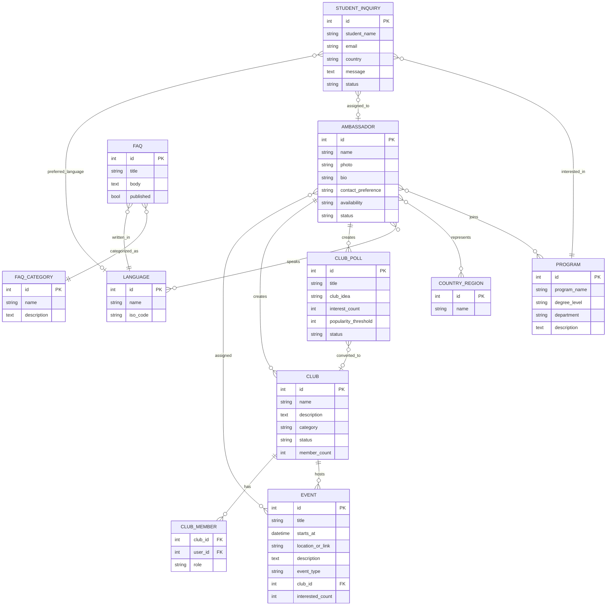

# ER Model

## Entities And Fields

- Ambassador: name, photo, degree program display field, countries/regions, languages, bio, contact preference, availability, status.
- Program: program name, degree level, department, description, related ambassadors.
- Country/Region: name, related languages, related ambassadors.
- Language: name, ISO code, related ambassadors.
- Event: title, date/time, location or online link, description, assigned ambassadors, optional club, event type, interested count.
- Club Poll: title, club idea, description, interest count, popularity threshold, status, creating ambassador.
- Club: name, description, category, status, member count, source poll, creating ambassador, members, events.
- Student Inquiry: student name, email, country, interested program, question/message, preferred language, assigned ambassador, status.
- FAQ: title, category, body/content, language, published status.
- FAQ Category: name, description, related FAQs.
